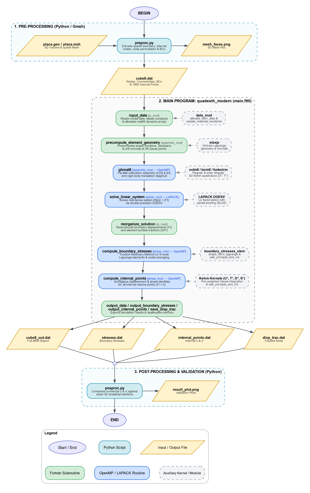

# Modernized BEM for Three-Dimensional Elastostatics using Quadratic Elements (QUADESTH)

[](https://fortran-lang.org/)
[](https://python.org/)
[](https://www.openmp.org/)
[](https://netlib.org/lapack/)
[]()

This repository contains a **Fortran 90 / OpenMP / LAPACK** implementation of the **QUADESTH** program: *A Boundary Element code using (QUAD)ratic elements for the solution of (E)elasto-(S)tatic (TH)ree-dimensional problems*. 

It is an evolution, modernization, and specialization of the original **QUADTHEH** dynamic code presented by José Dominguez in his textbook:

> **Dominguez, J. (1993)**. *Boundary Elements in Dynamics*. Computational Mechanics Publications, Southampton & Boston (Section 3.5).

The formulation solves 3D linear elastostatics problems using 9-node Lagrangian quadrilateral and 6-node triangular quadratic boundary elements, based on the **3D Kelvin fundamental solutions**.

---

## 🚀 Main Features

The monolithic Fortran 77 frequency-domain program (`quadtheh.for`) was thoroughly re-engineered into modern Fortran 90 standards and tailored specifically for **pure elastostatics**, eliminating all complex arithmetic overhead:

### 1. 3D Kelvin Fundamental Solutions
Employs exact real-valued displacement ($U_{ij}^\ast$) and surface traction ($T_{ij}^\ast$) fundamental solutions for the Kelvin problem in 3D:

$$
U_{ij}^\ast(x, \xi) = \frac{1}{16\pi (1-\nu)\mu r} \left[ (3 - 4\nu)\delta_{ij} + r_{,i} r_{,j} \right]
$$

$$
T_{ij}^\ast(x, \xi) = \frac{-1}{8\pi (1-\nu) r^2} \left\lbrace \frac{\partial r}{\partial n}\left[ (1 - 2\nu)\delta_{ij} + 3 r_{,i} r_{,j} \right] + (1 - 2\nu)\left( n_j r_{,i} - n_i r_{,j} \right) \right\rbrace
$$

### 2. Exact Rigid Body Translation Condition
The singular diagonal blocks of the influence matrix $H$ (containing the free-term tensor $C_{ij}(\xi)$ and the Cauchy Principal Value of $T_{ij}^\ast$) are determined directly and rigorously by applying rigid body translations ($\lbrace u \rbrace = \lbrace 1 \rbrace$, $\lbrace t \rbrace = \lbrace 0 \rbrace$):

$$
\sum_{j} H_{ij} = 0 \implies H_{ii} = - \sum_{j \neq i} H_{ij}
$$

This eliminates the need for dynamic frequency sweeps, complex exponentials, and Bessel series expansions (`tdif` / `hdif`).

### 3. Pure Real Double Precision (64-bit)
All arrays and system variables are strictly `real(dp)` (`real64`). This cuts memory consumption in half and avoids all complex number operations.

### 4. Optimized Linear System Solver (LAPACK `DGESV`)
Solves the fully populated system matrix using LAPACK's vectorized real double precision solver `DGESV` with partial pivoting.

### 5. OpenMP Parallel Collocation Assembly
The outer collocation loop in `ghmat8` is parallelized across CPU threads using OpenMP (`!$omp parallel do schedule(dynamic)`). Precomputed Gauss quadrature geometries allow assembling the entire 3D mesh in ~1 second.

### 6. Modern Modular Architecture
Decomposed into clean, maintainable Fortran modules (`data_mod.f90`, `solver_mod.f90`, `assembly_mod.f90`, `io_mod.f90`, `main.f90`) enforcing `IMPLICIT NONE` and dynamic memory allocation (`ALLOCATABLE`).

### 7. Automated Gmsh & Python Pipeline
- Seamless conversion from Gmsh quadratic quadrilateral meshes (`quad9`) via `meshio`.
- Node-ordering permutation algorithm aligning Gmsh sequencing `[0, 1, 2, 3, 4, 5, 6, 7, 8]` with Dominguez's boundary integration convention `[0, 4, 1, 5, 2, 6, 3, 7, 8]`.
- 3D physical surface visualization (`mesh_faces.png`) and automated analytical validation (`result_plot.png`).

### 8. Accurate Boundary Stress Recovery (Traction-Recovery Method)
Computes the full 3D Cauchy stress tensor ($\sigma_{xx}, \sigma_{yy}, \sigma_{zz}, \sigma_{xy}, \sigma_{yz}, \sigma_{zx}$), principal stresses ($\sigma_1 \ge \sigma_2 \ge \sigma_3$), and Von Mises equivalent stress directly on the boundary:
- Uses a local orthonormal coordinate frame $(\vec{e}_1, \vec{e}_2, \vec{e}_3)$ on each element surface, where $\vec{e}_3 = \vec{n}$ is the unit normal.
- Out-of-plane stresses are obtained directly from surface tractions: $\hat{\sigma}_{13} = \hat{t}_1, \hat{\sigma}_{23} = \hat{t}_2, \hat{\sigma}_{33} = \hat{t}_3$.
- In-plane strains ($\hat{\varepsilon}_{11}, \hat{\varepsilon}_{22}, \hat{\varepsilon}_{12}$) are derived from surface displacement gradients using analytical derivatives of **9-node Lagrangian quadrilateral** and **6-node quadratic triangular** elements (adapted from Gao & Davies, 2001).
- In-plane stresses are recovered via isotropic Hooke's Law:

$$
\hat{\sigma}_{11} = \frac{2\mu}{1-\nu}\hat{\varepsilon}_{11} + \frac{2\mu\nu}{1-\nu}\hat{\varepsilon}_{22} + \frac{\nu}{1-\nu}\hat{\sigma}_{33}
$$

$$
\hat{\sigma}_{22} = \frac{2\mu}{1-\nu}\hat{\varepsilon}_{22} + \frac{2\mu\nu}{1-\nu}\hat{\varepsilon}_{11} + \frac{\nu}{1-\nu}\hat{\sigma}_{33}
$$

$$
\hat{\sigma}_{12} = 2\mu\hat{\varepsilon}_{12}
$$

- Stresses are transformed back to global coordinates ($\boldsymbol{\sigma} = \mathbf{L}^T \hat{\boldsymbol{\sigma}} \mathbf{L}$) and averaged across adjacent elements at boundary nodes.

### 9. Somigliana Internal Point Solver (Displacements & Stresses)
Computes exact 3D displacement vectors and the full 3D Cauchy stress tensor at all internal volume points using the Somigliana identities:

$$
u_i(\boldsymbol{\xi}) = \int_{\Gamma} U_{ik}^\ast(\mathbf{x}, \boldsymbol{\xi}) t_k(\mathbf{x}) d\Gamma - \int_{\Gamma} T_{ik}^\ast(\mathbf{x}, \boldsymbol{\xi}) u_k(\mathbf{x}) d\Gamma
$$

$$
\sigma_{ij}(\boldsymbol{\xi}) = \int_{\Gamma} D_{kij}^\ast(\mathbf{x}, \boldsymbol{\xi}) t_k(\mathbf{x}) d\Gamma - \int_{\Gamma} S_{kij}^\ast(\mathbf{x}, \boldsymbol{\xi}) u_k(\mathbf{x}) d\Gamma
$$

Where the third-order ($D_{kij}^\ast$) and fourth-order ($S_{kij}^\ast$) Kelvin stress kernels are:

$$
D_{kij}^\ast = \frac{1}{8\pi (1-\nu) r^2} \left[ (1 - 2\nu) (\delta_{ki} r_{,j} + \delta_{kj} r_{,i} - \delta_{ij} r_{,k}) + 3 r_{,i} r_{,j} r_{,k} \right]
$$

$$
S_{kij}^\ast = \frac{\mu}{4\pi (1-\nu) r^3} \left\lbrace 3 \frac{\partial r}{\partial n} \left[ (1 - 2\nu) \delta_{ij} r_{,k} + \nu (\delta_{ki} r_{,j} + \delta_{kj} r_{,i}) - 5 r_{,i} r_{,j} r_{,k} \right] + 3\nu (n_i r_{,j} r_{,k} + n_j r_{,i} r_{,k}) + (1 - 2\nu) (3 n_k r_{,i} r_{,j} + n_j \delta_{ki} + n_i \delta_{kj}) - (1 - 4\nu) n_k \delta_{ij} \right\rbrace
$$

- **Adaptive High-Order Gauss-Legendre Quadrature for Quasi-Singularities**: Precomputes two-tier boundary Gauss-point tables — standard `6x6` (36 pts/elem) for far elements ($d > 3.5 R_e$) and `40x40` (1,600 pts/elem) for near-boundary elements ($d \le 3.5 R_e$) — completely eliminating $1/r^2$ and $1/r^3$ quasi-singular integration errors even for internal nodes very close to the boundary ($d / L_e \approx 0.07$).
- Boundary Gauss-point geometries and field variables ($u \cdot d\Gamma$ and $t \cdot d\Gamma$) are precomputed once, enabling OpenMP parallel evaluation over all 1,965 internal points in ~1.5 seconds wall-clock time.
- Outputs full displacement and stress tensors, principal stresses ($\sigma_1 \ge \sigma_2 \ge \sigma_3$), and Von Mises equivalent stress to `internal_points.dat`.

---

## 🔄 Program Architecture & Execution Flowchart

The complete computational workflow — spanning Gmsh/Python preprocessing, the modular Fortran 90 / OpenMP / LAPACK solver (`quadesth_modern`), and Python analytical validation — is illustrated below (generated via `fluxogram.py`):



---

## 📂 Repository Structure

```text
├── src / root
│   ├── main.f90              # Main driver (single-pass elastostatic solution)
│   ├── data_mod.f90          # Global data structures, dynamic arrays, and material constants
│   ├── assembly_mod.f90      # Parallel assembly (G & H), Gauss quadrature, and Kelvin solutions
│   ├── stress_mod.f90        # Boundary stress recovery & Somigliana internal points (OpenMP)
│   ├── solver_mod.f90        # Interface to LAPACK DGESV real linear solver
│   ├── io_mod.f90            # Flexible file readers, solution reorganization, and output
│   ├── Makefile              # GCC / GFortran build file
│   └── build.bat             # Windows compilation batch script
├── mesh / preproc
│   ├── placa.geo             # Gmsh script defining 3D volume geometry, physical groups, and mesh
│   ├── placa.msh             # Quadratic 3D volume & boundary element mesh (quad9)
│   └── preproc.py            # Preprocessor: Gmsh reader, internal points, BCs, and 3D visualizer
├── postproc / validation / docs
│   ├── posproc.py            # Postprocessor: 3D analytical validation and error metrics
│   ├── fluxogram.py          # Graphviz script generating the architecture flowchart
│   ├── flowchart.png         # Program architecture & execution pipeline diagram
│   ├── disp_trac.dat         # Tracked node displacement and traction output
│   ├── stresses.dat          # Complete boundary nodal stresses, Von Mises, and principal stresses
│   ├── internal_points.dat   # Complete internal points displacements, Cauchy stresses, and Von Mises
│   ├── cube8.dat             # Simulation input file generated from mesh
│   ├── cube8_out.dat         # Detailed node displacements, element tractions, and internal points
│   ├── mesh_faces.png        # 3D boundary mesh faces visualization
│   └── result_plot.png       # Numerical vs Analytical validation plot
└── readme.md
```

---

## ⚙️ Compilation & Prerequisites

### Prerequisites
- **GFortran** (GCC 10 or later recommended)
- **LAPACK & BLAS** libraries
- **OpenMP** runtime library (`libgomp`)
- **Python 3.8+** with `numpy`, `matplotlib`, and `meshio`

#### Installing Prerequisites on Windows (MSYS2 UCRT64 / MinGW):
```bash
pacman -S mingw-w64-ucrt-x86_64-gcc-fortran \
          mingw-w64-ucrt-x86_64-lapack \
          mingw-w64-ucrt-x86_64-make
```

#### Installing Prerequisites on Ubuntu / Debian:
```bash
sudo apt-get update
sudo apt-get install gfortran liblapack-dev libblas-dev make python3-pip
pip install numpy matplotlib meshio
```

### Compiling the Solver

#### Using Make:
```bash
make
```
*(On Windows MSYS2, use `mingw32-make` or `make`)*

#### Using the Windows Batch Script:
```cmd
build.bat
```

This compiles all modules with `-O3 -fopenmp -fdefault-real-8 -static -llapack -lblas` and generates `quadesth_modern.exe`.

---

## 🔬 Benchmark Problem: Uniaxial Strain on a 3D Elastic Cube

The implementation is verified against the 1D uniaxial strain benchmark (oedometric condition):

* **Geometry**: $6\text{ m} \times 6\text{ m} \times 6\text{ m}$ elastic cube ($L = 6\text{ m}$).
* **Material Properties**:
  * Shear modulus: $\mu = 1.0 \times 10^6\text{ N/m}^2$
  * Poisson's ratio: $\nu = 0.25$
  * Young's modulus: $E = 2\mu(1+\nu) = 2.5 \times 10^6\text{ N/m}^2$
  * Constrained (oedometric) modulus: $M = \frac{E(1-\nu)}{(1+\nu)(1-2\nu)} = 3.0 \times 10^6\text{ N/m}^2$
* **Boundary Conditions**:
  * **Upper Face ($z = 6\text{ m}$, `sup1`)**: Uniform normal traction $p = 100\text{ N/m}^2$; zero shear tractions.
  * **Bottom Face ($z = 0\text{ m}$, `sup3`)**: Constrained normal displacement ($u_z = 0$); zero shear tractions.
  * **Lateral Faces ($x = 0, 6\text{ m}$ and $y = 0, 6\text{ m}$)**: Roller supports with constrained normal displacements ($u_x = 0$ or $u_y = 0$); zero shear tractions.
* **Discretization**:
  * 216 quadratic quadrilateral boundary elements (9-node Lagrangian quadrilaterals, 36 elements per face).
  * 866 boundary collocation nodes (2598 degrees of freedom).
  * 1965 internal evaluation points extracted from the 3D volume mesh (`placa.msh`).

---

## 🏃 Workflow & Execution

### 1. Preprocessing & Mesh Visualization
Generate the clean elastostatic input file and visualize the mesh:
```bash
python preproc.py
```
This reads `placa.msh`, extracts boundary elements and internal volume nodes, generates `cube8.dat` (and `quad8.dat`), detects the top-center monitor node at $(3, 3, 6)$ (Node 770), and exports `mesh_faces.png`:


### 2. Numerical Simulation
Execute the parallel Fortran 90 elastostatics solver:
```bash
./quadesth_modern.exe
```

Console output:
```text
=============================================================
 QUADESTH Modernized BEM 3D Elastostatics Solver
 Quadratic Elements - Kelvin Fundamental Solution
 OpenMP Parallelization & LAPACK Real Solver (DGESV)
 Boundary Stresses (Traction-Recovery Method)
=============================================================
 OpenMP threads available:    8
 Tracking Node =    770
 Mesh loaded:    866 nodes,    216 elements, 1965 internal points.
 Precomputing element Gauss point geometries...
 Assembling influence matrices (G and H)... done in   0.95 s
 Solving linear system with LAPACK DGESV... done in   2.11 s
 Computing boundary stresses (Traction-Recovery)... done in   0.00 s
 Computing internal displacements and stresses for   1965 points... done in   5.56 s
 Boundary stresses exported to: stresses.dat
 Internal points exported to: internal_points.dat
=============================================================
 Computation completed successfully in     8.77 s
 Results exported to: cube8_out.dat, stresses.dat, internal_points.dat and disp_trac.dat
=============================================================
```

### 3. Post-Processing & Validation
Validate the results against the analytical solution ($u_z(z) = \frac{p \cdot z}{M}$):
```bash
python posproc.py
```

---

## 📈 Validation Results

Under uniaxial strain conditions, the analytical solution yields a linear vertical displacement profile:

$$
u_z(z) = \frac{p \cdot z}{M}
$$

- At the upper face ($z = 6\text{ m}$): $u_z^{\text{analyt}} = \frac{100 \times 6}{3.0 \times 10^6} = 2.00000 \times 10^{-4}\text{ m}$
- At the domain center ($z = 3\text{ m}$): $u_z^{\text{analyt}} = \frac{100 \times 3}{3.0 \times 10^6} = 1.00000 \times 10^{-4}\text{ m}$

### Comparison Summary:

#### 1. Displacements and Applied Tractions:
| Evaluation Point | Coordinate $z$ | Numerical (QUADESTH) | Analytical | Relative Error |
| :--- | :---: | :---: | :---: | :---: |
| **Top-center Node 770 ($u_z$)** | $6.0\text{ m}$ | $1.999998 \times 10^{-4}\text{ m}$ | $2.000000 \times 10^{-4}\text{ m}$ | **0.0001 %** |
| **Central Internal Point #1880 ($u_z$)** | $3.0\text{ m}$ | $0.999998 \times 10^{-4}\text{ m}$ | $1.000000 \times 10^{-4}\text{ m}$ | **0.0002 %** |
| **Top Traction $t_z$** | $6.0\text{ m}$ | $100.00000\text{ N/m}^2$ | $100.00000\text{ N/m}^2$ | **0.0000 %** |

#### 2. Recovered Boundary Stresses (Traction-Recovery Method):
| Stress Component | Node / Region | Numerical (QUADESTH) | Analytical | Relative Error |
| :--- | :---: | :---: | :---: | :---: |
| **Vertical Stress $\sigma_{zz}$** | Node 770 ($z=6\text{m}$) | $100.0000\text{ Pa}$ | $100.0000\text{ Pa}$ | **0.0000 %** |
| **Lateral Stress $\sigma_{xx}$** | Node 770 ($z=6\text{m}$) | $33.3334\text{ Pa}$ | $33.3333\text{ Pa}$ | **0.0002 %** |
| **Lateral Stress $\sigma_{yy}$** | Node 770 ($z=6\text{m}$) | $33.3334\text{ Pa}$ | $33.3333\text{ Pa}$ | **0.0002 %** |
| **Von Mises Stress $\sigma_{vm}$** | Node 770 ($z=6\text{m}$) | $66.6666\text{ Pa}$ | $66.6667\text{ Pa}$ | **0.0001 %** |
| **Mean $\sigma_{zz}$ (Mesh Average)** | All 866 nodes | $99.9998 \pm 0.0024\text{ Pa}$ | $100.0000\text{ Pa}$ | **0.0002 %** |
| **Mean $\sigma_{xx}$ (Mesh Average)** | All 866 nodes | $33.3332 \pm 0.0015\text{ Pa}$ | $33.3333\text{ Pa}$ | **0.0003 %** |
| **Mean $\sigma_{yy}$ (Mesh Average)** | All 866 nodes | $33.3332 \pm 0.0015\text{ Pa}$ | $33.3333\text{ Pa}$ | **0.0003 %** |
| **Mean $\sigma_{vm}$ (Mesh Average)** | All 866 nodes | $66.6666 \pm 0.0022\text{ Pa}$ | $66.6667\text{ Pa}$ | **0.0001 %** |

#### 3. Internal Points Displacements & Stresses (Somigliana Identities — Adaptive `40x40` / `6x6` Quadrature):
| Quantity / Component | Region / Point | Numerical (QUADESTH) | Analytical | Relative Error |
| :--- | :---: | :---: | :---: | :---: |
| **Displacement $u_z$** | Central Point #1880 ($z=3\text{m}$) | $0.999998 \times 10^{-4}\text{ m}$ | $1.000000 \times 10^{-4}\text{ m}$ | **0.0002 %** |
| **Vertical Stress $\sigma_{zz}$** | Central Point #1880 ($z=3\text{m}$) | $99.9999\text{ Pa}$ | $100.0000\text{ Pa}$ | **0.0001 %** |
| **Lateral Stress $\sigma_{xx}$** | Central Point #1880 ($z=3\text{m}$) | $33.3333\text{ Pa}$ | $33.3333\text{ Pa}$ | **0.0000 %** |
| **Lateral Stress $\sigma_{yy}$** | Central Point #1880 ($z=3\text{m}$) | $33.3333\text{ Pa}$ | $33.3333\text{ Pa}$ | **0.0000 %** |
| **Von Mises Stress $\sigma_{vm}$** | Central Point #1880 ($z=3\text{m}$) | $66.6666\text{ Pa}$ | $66.6667\text{ Pa}$ | **0.0002 %** |
| **Mean / Max $u_z$ Error** | **All 1,965 Internal Points** ($d \ge 0.073\text{m}$) | — | — | **0.0003 % / 0.0031 %** |
| **Mean $\sigma_{zz}$** | **All 1,965 Internal Points** | $100.0002 \pm 0.0158\text{ Pa}$ | $100.0000\text{ Pa}$ | **0.0002 %** |
| **Mean $\sigma_{xx}$** | **All 1,965 Internal Points** | $33.3331 \pm 0.0150\text{ Pa}$ | $33.3333\text{ Pa}$ | **0.0006 %** |
| **Mean $\sigma_{yy}$** | **All 1,965 Internal Points** | $33.3332 \pm 0.0107\text{ Pa}$ | $33.3333\text{ Pa}$ | **0.0003 %** |
| **Mean $\sigma_{vm}$** | **All 1,965 Internal Points** | $66.6671 \pm 0.0253\text{ Pa}$ | $66.6667\text{ Pa}$ | **0.0006 %** |


---

## 📖 References

* **Dominguez, J.** (1993). *Boundary Elements in Dynamics*. Computational Mechanics Publications, Southampton & Boston. ISBN: 1-85312-258-0.
* **Gao, X.-W., & Davies, T. G.** (2001). *Boundary Element Programming in Mechanics*. Cambridge University Press. ISBN: 978-0521772594.
* **Brebbia, C. A., & Dominguez, J.** (1992). *Boundary Elements: An Introductory Course*. Computational Mechanics Publications & McGraw-Hill.
