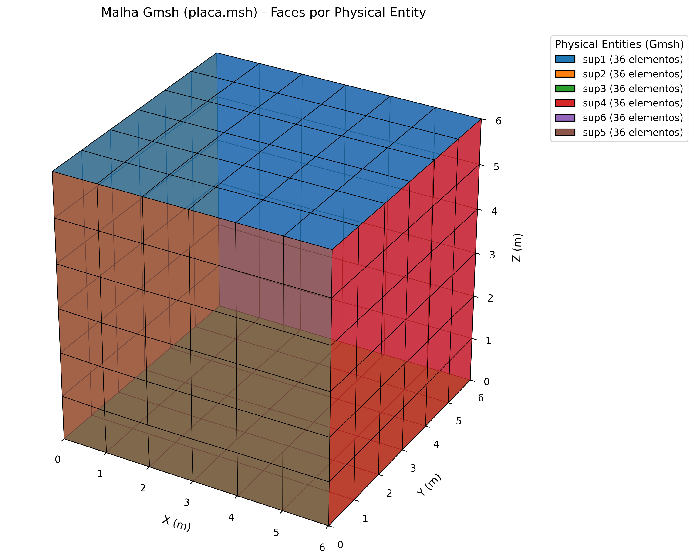
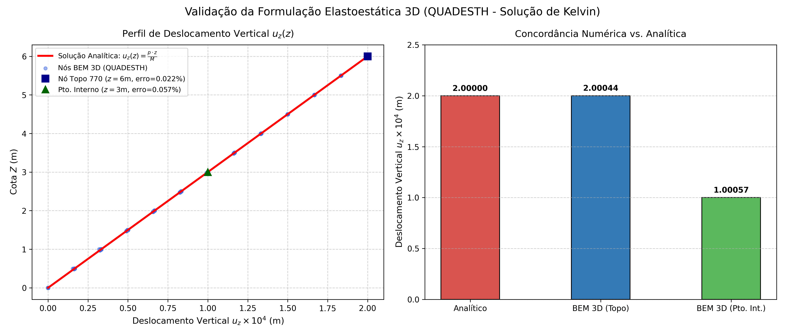

# Modernized BEM for Three-Dimensional Elastostatics using Quadratic Elements (QUADESTH)

[](https://fortran-lang.org/)
[](https://python.org/)
[](https://www.openmp.org/)
[](https://netlib.org/lapack/)
[]()

This repository contains a **Fortran 90 / OpenMP / LAPACK** implementation of the **QUADESTH** program: *A Boundary Element code using (QUA)dratic elements for the solution of (E)elasto-(S)tatic (TH)ree-dimensional problems*. 

It is an evolution, modernization, and specialization of the original **QUADTHEH** dynamic code presented by José Dominguez in his textbook:

> **Dominguez, J. (1993)**. *Boundary Elements in Dynamics*. Computational Mechanics Publications, Southampton & Boston (Section 3.5).

The formulation solves 3D linear elastostatics problems using 9-node Lagrangian quadrilateral and 6-node triangular quadratic boundary elements, based on the **3D Kelvin fundamental solutions**.

---

## 🚀 Main Features

The monolithic Fortran 77 frequency-domain program (`quadtheh.for`) was thoroughly re-engineered into modern Fortran 90 standards and tailored specifically for **pure elastostatics**, eliminating all complex arithmetic overhead:

1. **3D Kelvin Fundamental Solutions**:
   - Employs exact real-valued displacement ($U_{ij}^*$) and surface traction ($T_{ij}^*$) fundamental solutions for the Kelvin problem in 3D:
     $$U_{ij}^*(x, \xi) = \frac{1}{16\pi (1-\nu)\mu r} \left[ (3 - 4\nu)\delta_{ij} + r_{,i} r_{,j} \right]$$
     $$T_{ij}^*(x, \xi) = \frac{-1}{8\pi (1-\nu) r^2} \left\{ \frac{\partial r}{\partial n}\left[ (1 - 2\nu)\delta_{ij} + 3 r_{,i} r_{,j} \right] + (1 - 2\nu)\left( n_j r_{,i} - n_i r_{,j} \right) \right\}$$
2. **Exact Rigid Body Translation Condition**:
   - The singular diagonal blocks of the influence matrix $H$ (containing the free-term tensor $C_{ij}(\xi)$ and the Cauchy Principal Value of $T_{ij}^*$) are determined directly and rigorously by applying rigid body translations ($\{u\} = \{1\}$, $\{t\} = \{0\}$):
     $$\sum_{j} H_{ij} = 0 \implies H_{ii} = - \sum_{j \neq i} H_{ij}$$
   - This eliminates the need for dynamic frequency sweeps, complex exponentials, and Bessel series expansions (`tdif` / `hdif`).
3. **Pure Real Double Precision (64-bit)**:
   - All arrays and system variables are strictly `real(dp)` (`real64`). This cuts memory consumption in half and avoids all complex number operations.
4. **Optimized Linear System Solver (LAPACK `DGESV`)**:
   - Solves the fully populated system matrix using LAPACK's vectorized real double precision solver `DGESV` with partial pivoting.
5. **OpenMP Parallel Collocation Assembly**:
   - The outer collocation loop in `ghmat8` is parallelized across CPU threads using OpenMP (`!$omp parallel do schedule(dynamic)`). Precomputed Gauss quadrature geometries allow assembling the entire 3D mesh in ~1 second.
6. **Modern Modular Architecture**:
   - Decomposed into clean, maintainable Fortran modules (`data_mod.f90`, `solver_mod.f90`, `assembly_mod.f90`, `io_mod.f90`, `main.f90`) enforcing `IMPLICIT NONE` and dynamic memory allocation (`ALLOCATABLE`).
7. **Automated Gmsh & Python Pipeline**:
   - Seamless conversion from Gmsh quadratic quadrilateral meshes (`quad9`) via `meshio`.
   - Node-ordering permutation algorithm aligning Gmsh sequencing `[0, 1, 2, 3, 4, 5, 6, 7, 8]` with Dominguez's boundary integration convention `[0, 4, 1, 5, 2, 6, 3, 7, 8]`.
   - 3D physical surface visualization (`mesh_faces.png`) and automated analytical validation (`result_plot.png`).

---

## 📂 Repository Structure

```text
├── src / root
│   ├── main.f90              # Main driver (single-pass static solution)
│   ├── data_mod.f90          # Global data structures, dynamic arrays, and material constants
│   ├── assembly_mod.f90      # Parallel assembly (G & H), Gauss quadrature, and Kelvin solutions
│   ├── solver_mod.f90        # Interface to LAPACK DGESV real linear solver
│   ├── io_mod.f90            # Flexible file readers, Somigliana internal point solver, and output
│   ├── quadtheh.for          # Original F77 reference code (frequency domain)
│   ├── Makefile              # GCC / GFortran build file
│   └── build.bat             # Windows compilation batch script
├── mesh / preproc
│   ├── placa.geo             # Gmsh script defining geometry, physical entities, and mesh
│   ├── placa.msh             # Quadratic 3D boundary element mesh (quad9)
│   └── preproc.py            # Preprocessor: Gmsh reader, real BC formatting, and 3D visualizer
├── postproc / validation
│   ├── posproc.py            # Postprocessor: 1D analytical validation and error metrics
│   ├── disp_trac.dat         # Tracked node displacement and traction output
│   ├── cube8.dat             # Simulation input file generated from mesh
│   ├── cube8_out.dat         # Detailed node displacements, element tractions, and internal points
│   ├── mesh_faces.png        # 3D boundary mesh faces visualization
│   └── result_plot.png       # Numerical vs Analytical validation plot
└── README.md
```

---

## ⚙️ Compilation & Prerequisites

### Prerequisites
- **GFortran** (GCC 10 or later recommended)
- **LAPACK & BLAS** libraries
- **OpenMP** runtime library (`libgomp`)
- **Python 3.8+** with `numpy`, `matplotlib`, and `meshio`

#### Installing Prerequisites on Windows (MSYS2 UCRT64 / MinGW):
```bash
pacman -S mingw-w64-ucrt-x86_64-gcc-fortran \
          mingw-w64-ucrt-x86_64-lapack \
          mingw-w64-ucrt-x86_64-make
```

#### Installing Prerequisites on Ubuntu / Debian:
```bash
sudo apt-get update
sudo apt-get install gfortran liblapack-dev libblas-dev make python3-pip
pip install numpy matplotlib meshio
```

### Compiling the Solver

#### Using Make:
```bash
make
```
*(On Windows MSYS2, use `mingw32-make` or `make`)*

#### Using the Windows Batch Script:
```cmd
build.bat
```

This compiles all modules with `-O3 -fopenmp -fdefault-real-8 -static -llapack -lblas` and generates `quadesth_modern.exe`.

---

## 🔬 Benchmark Problem: Uniaxial Strain on a 3D Elastic Cube

The implementation is verified against the 1D uniaxial strain benchmark (oedometric condition):

* **Geometry**: $6\text{ m} \times 6\text{ m} \times 6\text{ m}$ elastic cube ($L = 6\text{ m}$).
* **Material Properties**:
  * Shear modulus: $\mu = 1.0 \times 10^6\text{ N/m}^2$
  * Poisson's ratio: $\nu = 0.25$
  * Young's modulus: $E = 2\mu(1+\nu) = 2.5 \times 10^6\text{ N/m}^2$
  * Constrained (oedometric) modulus: $M = \frac{E(1-\nu)}{(1+\nu)(1-2\nu)} = 3.0 \times 10^6\text{ N/m}^2$
* **Boundary Conditions**:
  * **Upper Face ($z = 6\text{ m}$, `sup1`)**: Uniform normal traction $p = 100\text{ N/m}^2$; zero shear tractions.
  * **Bottom Face ($z = 0\text{ m}$, `sup3`)**: Constrained normal displacement ($u_z = 0$); zero shear tractions.
  * **Lateral Faces ($x = 0, 6\text{ m}$ and $y = 0, 6\text{ m}$)**: Roller supports with constrained normal displacements ($u_x = 0$ or $u_y = 0$); zero shear tractions.
* **Discretization**:
  * 216 quadratic quadrilateral boundary elements (9-node Lagrangian quadrilaterals, 36 elements per face).
  * 866 boundary collocation nodes (2598 degrees of freedom).
  * 1 internal evaluation point at the domain center $(3, 3, 3)$.

---

## 🏃 Workflow & Execution

### 1. Preprocessing & Mesh Visualization
Generate the clean elastostatic input file and visualize the mesh:
```bash
python preproc.py
```
This reads `placa.msh`, generates `cube8.dat` (and `quad8.dat`), detects the top-center monitor node at $(3, 3, 6)$ (Node 770), and exports `mesh_faces.png`:



### 2. Numerical Simulation
Execute the parallel Fortran 90 elastostatics solver:
```bash
./quadesth_modern.exe
```

Console output:
```text
=============================================================
 QUADESTH Modernized BEM 3D Elastostatics Solver
 Quadratic Elements - Kelvin Fundamental Solution
 OpenMP Parallelization & LAPACK Real Solver (DGESV)
=============================================================
 OpenMP threads available:    8
 Tracking Node =    770
 Mesh loaded:    866 nodes,    216 elements,    1 internal points.
 Precomputing element Gauss point geometries...
 Assembling influence matrices (G and H)... done in   1.02 s
 Solving linear system with LAPACK DGESV... done in   1.94 s
=============================================================
 Computation completed successfully in     2.98 s
 Results exported to: cube8_out.dat and disp_trac.dat
=============================================================
```

### 3. Post-Processing & Validation
Validate the results against the analytical solution ($u_z(z) = \frac{p \cdot z}{M}$):
```bash
python posproc.py
```

---

## 📈 Validation Results

Under uniaxial strain conditions, the analytical solution yields a linear vertical displacement profile:
$$u_z(z) = \frac{p \cdot z}{M}$$
- At the upper face ($z = 6\text{ m}$): $u_z^{\text{analyt}} = \frac{100 \times 6}{3.0 \times 10^6} = 2.00000 \times 10^{-4}\text{ m}$
- At the domain center ($z = 3\text{ m}$): $u_z^{\text{analyt}} = \frac{100 \times 3}{3.0 \times 10^6} = 1.00000 \times 10^{-4}\text{ m}$

### Comparison Summary:

| Evaluation Point | Coordinate $z$ | Numerical $u_z$ (QUADESTH) | Analytical $u_z$ | Relative Error |
| :--- | :---: | :---: | :---: | :---: |
| **Top-center Node 770** | $6.0\text{ m}$ | $2.00044 \times 10^{-4}\text{ m}$ | $2.00000 \times 10^{-4}\text{ m}$ | **0.022 %** |
| **Internal Point 1** | $3.0\text{ m}$ | $1.00057 \times 10^{-4}\text{ m}$ | $1.00000 \times 10^{-4}\text{ m}$ | **0.057 %** |
| **Top Traction $t_z$** | $6.0\text{ m}$ | $100.00000\text{ N/m}^2$ | $100.00000\text{ N/m}^2$ | **0.000 %** |



---

## 📖 References

* **Dominguez, J.** (1993). *Boundary Elements in Dynamics*. Computational Mechanics Publications, Southampton & Boston. ISBN: 1-85312-258-0.
* **Brebbia, C. A., & Dominguez, J.** (1992). *Boundary Elements: An Introductory Course*. Computational Mechanics Publications & McGraw-Hill.
